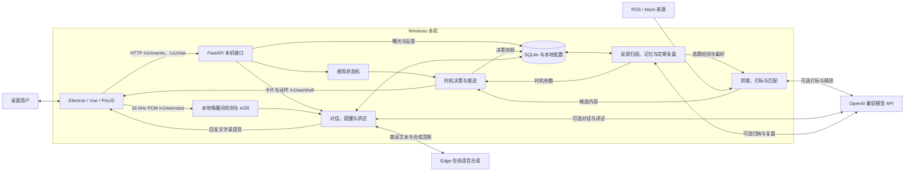

# Elf Buddy

Elf Buddy 是一只常驻 Windows 桌面的 AI 兴趣精灵。它把 RSS 里的新内容筛成少量候选，根据用户的空闲状态决定何时提示，并把打开、追问和评价记下来，逐步调整之后的推荐。

## 背景与使用场景

工作间隙通常很短，主动订阅、搜索和翻看信息流需要额外精力，固定时间的推送又可能打断正在进行的工作。Elf Buddy 将内容筛选放在后台，把交互放到桌面。会议、锁屏和安静时段会限制主动提示，用户也可以随时主动打开对话。

| 场景 | 使用方式 |
| --- | --- |
| 短暂休息时了解关注的领域 | 引导页选择兴趣和 RSS 来源。精灵会在合适的时机给出动作或资讯气泡，卡片可打开原文、追问或评价。 |
| 想马上看资讯或聊两句 | 点击精灵互动，也可以在对话里问「有什么新闻」。资讯回答会使用已抓取的条目。 |
| 设置提醒或使用语音 | 对话里输入「提醒我 20 分钟后休息」。开启麦克风后，可以叫精灵的名字，再说出指令。 |
| 查看和纠正偏好 | 双击精灵查看成长面板，浏览兴趣和记忆统计。可以在对话或设置中表达偏好的变化。 |
| 自定义桌宠 | 引导页和设置支持调整名字、颜色、眼睛与装饰。也可以选用自己的图片皮肤。 |

## 技术架构

| 模块 | 实现 |
| --- | --- |
| 桌宠壳 | Electron 主进程管理透明置顶窗口、点击穿透、锁屏和空闲采集。Vue 3、TypeScript 和 PixiJS 负责程序动画、气泡、语音控制、引导与设置。 |
| 本机后端 | Python 3.12、FastAPI 和 Uvicorn。桌宠通过 `127.0.0.1:8787` 的 HTTP 上报事件、查询设置或对话，通过 WebSocket 接收推送。便携版由 Electron 启动后端并共享随机会话令牌。 |
| 内容筛选 | 定期抓取 RSS/Atom，提取标题、摘要、发布时间等字段。先按相关度和新鲜度筛选，再尝试用配置的模型精排。无模型或调用失败时，打标与排序可退回规则。 |
| 时机决策 | 状态变化、周期巡逻和候选更新都可触发评估。时机引擎使用内容价值、用户状态、时段和打扰成本计算分数，并检查配额，决定静默、轻提示、动作吸引或主动气泡。 |
| 记忆与成长 | SQLite 保存事件、兴趣图谱、画像、提醒和汇报。点击、停留、追问与评价按决策 ID 归因。夜间和周末任务复盘样本，更新时机参数，按条件沉淀选题经验。 |
| 音频与图像 | sherpa-onnx 在本地完成唤醒词检测和语音识别。朗读可使用在线 Edge TTS，失败时回退系统语音。图片皮肤可用 ONNX Runtime Web 和 ISNet 在本地抠图。 |

早期设计探索了 Graphiti、Live2D、向量召回和 RSSHub。当前源码使用 SQLite 兴趣图谱、PixiJS 程序动画、规则粗筛与可选 LLM 精排，并直接读取配置的 RSS/Atom 地址。

## 数据流



桌宠上报空闲、锁屏和前台分类事件。前台事件还包含本机进程名，随事件写入本机 SQLite，采集代码不读取窗口标题。麦克风 PCM 只在本机环回传送。启用外部模型时，对话文本、相关记忆或候选摘要可能进入模型请求。在线朗读会把待朗读文本发送给 Edge TTS。

## 公开仓库目录

```text
Elf-buddy/
├── README.md
├── .gitignore
├── start.ps1                       # Windows 开发启动
├── scripts/
│   ├── build.ps1                   # PyInstaller + Electron Builder 打包
│   ├── ensure-node.ps1             # 检测或下载 Node.js
│   ├── prepare-assets.ps1          # 从上游准备 PixiJS 与可选的抠图资源
│   └── fix-encoding.ps1
├── elf-shell/
│   ├── electron/                   # 主进程与预加载桥接
│   ├── src/
│   │   ├── App.vue                 # 桌宠交互、卡片与成长面板
│   │   ├── components/             # 首次引导与设置
│   │   ├── pet/                    # 精灵渲染、动画与皮肤抠图
│   │   ├── brain.ts                # 本地 HTTP 和 WebSocket 客户端
│   │   └── voice.ts                # 麦克风采样与语音会话
│   └── package.json / package-lock.json
├── elf-brain/
│   ├── run.py / brain.spec / requirements.txt
│   ├── .env.example                # API key 留空的配置模板
│   └── app/
│       ├── main.py                # API、WebSocket、调度及应用接线
│       ├── core/                  # 本机路径、配置与 LLM 客户端
│       ├── perception/ / timing/  # 感知、开口决策与默认系数
│       ├── content/ / speak/      # RSS 内容处理、推荐表达
│       ├── memory/ / growth/      # 事件、兴趣、画像、提醒和关系账户
│       └── review/ / voice/ / story/
└── docs/                          # 架构、数据模型、接口、算法及实现记录
```

## 开发启动

使用 Windows 10/11、PowerShell、Python 3.12 和 Node.js 22。首次运行需要联网安装依赖与获取 PixiJS。启动脚本会在缺少 Node.js 时尝试下载便携版。

```powershell
git clone https://github.com/lanszdg/Elf-buddy.git
Set-Location Elf-buddy
.\start.ps1
```

启动脚本会分别打开后端和桌宠窗口。桌宠首次启动时会进入引导，设置精灵名字、形象、兴趣和 RSS 源。右键打开设置，双击打开成长面板。关闭对应的开发窗口即可停止相应进程。

也可以用两个 PowerShell 窗口分别运行。第一个窗口从仓库根目录执行以下命令。

```powershell
Set-Location elf-brain
python -m venv .venv
.\.venv\Scripts\python.exe -m pip install -r requirements.txt
.\.venv\Scripts\python.exe run.py
```

第二个窗口从仓库根目录执行以下命令。

```powershell
Set-Location elf-shell
npm ci
..\scripts\prepare-assets.ps1
npm run dev
```

开发默认未设置 `ELF_TOKEN` 时，可以用以下命令检查后端。

```powershell
Invoke-RestMethod -Uri http://127.0.0.1:8787/v1/profile
```

需要在开发中启用认证时，在两个启动窗口中设置相同的 `ELF_TOKEN`，HTTP 诊断请求也要带 `X-Elf-Token` 请求头。

### 配置模型与可选资源

- **模型 API**。可以在桌宠设置里填写 OpenAI 兼容 Base URL、API key 和模型名，也可复制 `elf-brain/.env.example` 到开发数据目录 `elf-brain/data/.env` 后填写，再重启后端。环境变量优先于文件。
- **无模型运行**。可以体验桌宠形象、RSS 规则筛选和本地提醒。开放式对话、个性化讲述及模型复盘的效果取决于模型配置。
- **语音**。在设置中开启麦克风并确认 Windows 权限。首次启用时后端会下载本地识别模型到数据目录下的 `voice/`。
- **图片皮肤自动抠图**。安装 npm 依赖后从仓库根目录执行 `.\scripts\prepare-assets.ps1 -WithSkinCutout`。脚本会下载并校验 ISNet 权重，复制匹配版本的 ONNX Runtime Web。资源缺失时皮肤保留原图。第三方模型注明了自己的许可。 [ISNet-ONNX 模型卡](https://huggingface.co/onnx-community/ISNet-ONNX)

### 打包便携版

在 Windows 的仓库根目录执行以下命令。

```powershell
.\scripts\build.ps1
```

生成文件为 `elf-shell/release-new/ElfBuddy-portable-0.1.0.exe`。已经生成后端程序时可用 `-SkipBrain` 仅重打壳。打包读取 `elf-shell/models/` 中已准备好的资源，开启抠图时需按需准备权重并遵循上游模型许可。

## 本地数据与脱敏

源码启动时，后端数据默认写入 `elf-brain/data/`，可用 `ELF_DATA_DIR` 指定。便携版默认写到 `%APPDATA%\Elf Buddy\data\`，Electron 的缓存和本地存储位于其应用数据目录中。公开仓库只包含源码、默认参数、依赖清单、脚本、文档和空密钥模板。实际 `.env`、数据库、用户画像、日志、调试截图、安装包和下载缓存保存在本地，已加入忽略规则。

## 开发文档

- [架构设计基线](docs/01-architecture.md)
- [数据模型设计](docs/02-data-model.md)
- [HTTP 与 WebSocket 接口](docs/03-interfaces.md)
- [打分、校准和匹配算法](docs/04-algorithms.md)
- [实施记录与验收路径](docs/05-implementation-plan.md)
