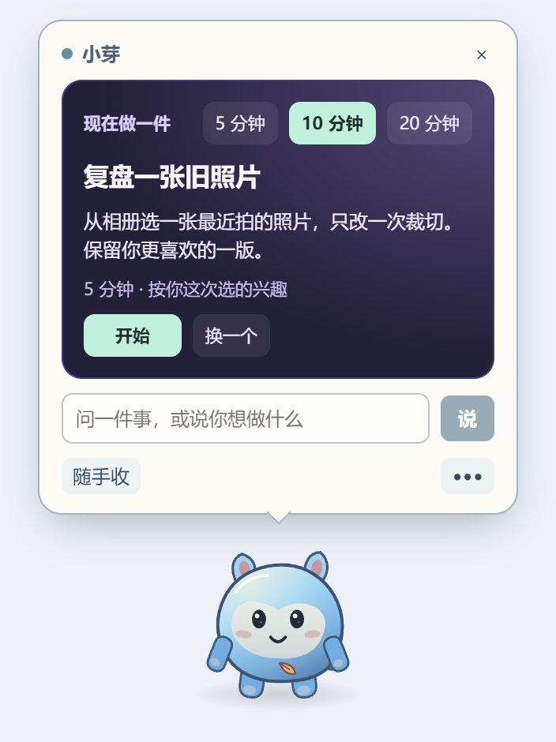
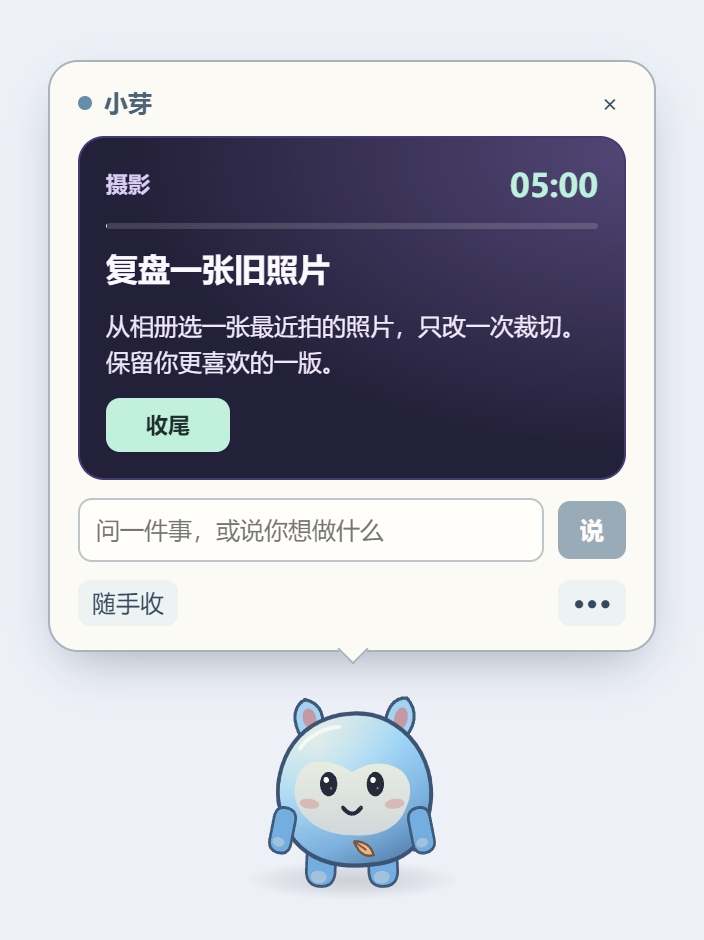
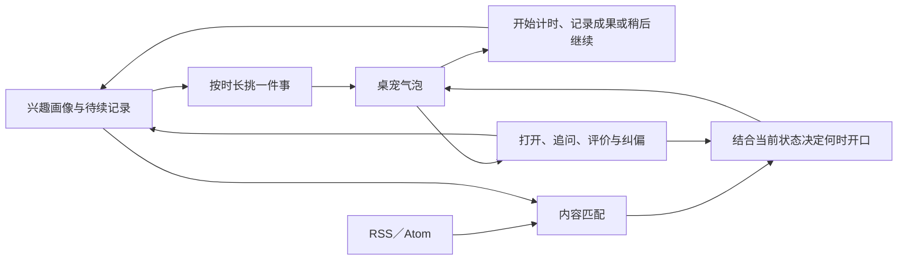

# Elf Buddy

**有五分钟空闲，就动手做一点你喜欢的事。** Elf Buddy 是一只常驻 Windows 桌面的兴趣精灵。它记得你关注什么、上次停在哪儿，也会在你方便的时候带来一条值得看的消息。

如果你喜欢摄影，打开精灵，它可能递来一个五分钟的小练习「从相册挑一张旧照片，只改一次裁切」。可以开始计时、换一个练习，或者写下试出来的结果。下次打开时，它会把上一次的笔记带回来。

<table>
<tr>
<td align="center"><br>点精灵就有一件可以马上做的事</td>
<td align="center"><br>开始、收尾、留下成果或下一步</td>
</tr>
</table>

截图取自 Electron 实际界面，使用合成兴趣和记录。 [看拖拽演示](media/elf-buddy-drag.gif) · [成长面板](media/growth.png) · [推荐卡](media/recommendation.png)

## 什么时候会用到它

| 你的场景 | 怎么用 |
| --- | --- |
| 刚忙完，想为兴趣做点什么 | 单击精灵，选 5、10 或 20 分钟。行动卡从你的兴趣、到期的待续事项和匹配的清单里挑一件，给出能执行的第一步。常见兴趣有内置练习，首次使用可以直接开始。 |
| 做到一半被打断 | 点击「收尾 → 晚点继续」，留下下一步。到期后在桌宠旁看到提示。随手收的链接、笔记和推荐卡也可以这样留到稍后。 |
| 想了解关注领域的近况 | 精灵从订阅的 RSS／Atom 中挑内容，结合空闲、锁屏、会议和安静时段决定什么时候出现。可以看原文、追问「这和我在做的东西有什么关系」或评价推荐。 |
| 已经做了点东西，想比较结果 | 在对话里说「帮我对照两张照片」可同步检查相同区域的亮度分布。也可以对照几份资料、跟踪 GitHub 发布、筛选活动并导出日历，或整理保存过的成果。 |
| 想看看它怎样逐渐懂你 | 双击查看兴趣温度、记忆条数、品味画像和等级。也可以在设置里纠正「以后少推荐这个方向」。 |
| 想让精灵有自己的样子 | 在气泡的「···」里选择「换个形象」。可调体形、眼距、四肢与耳朵等，或导入手绘。内置形象抓起后手脚和耳朵会随拖拽方向摆动，慢放回弹，快甩有惯性。 |

## 记忆、成长和反馈怎么起作用

- **记住你在意的东西。** 明确选过的兴趣、能从对话提取的事实、交互带来的偏好变化，会写入本机的 SQLite 画像与兴趣图谱。兴趣能升温、冷却或暂停。配置模型可以从自由对话提取长期事实。
- **从反馈改推荐。** 推荐决定与当时的状态有独立 ID。打开、停留、追问、赞踩等反馈会归到对应推荐。后台夜间和周复盘会校准候选评分及开口时机。配置模型且样本充足时，周复盘还能从反馈提炼策略，并先在历史案例上回放验证。
- **从实际行动接着做。** 建议会考虑时间、兴趣、到期事项和近期行动结果。启动的计时能跨重启恢复。你留下的成果所见即所得，最后一条完成笔记会出现在下次行动卡上。点「晚点继续」会把下一步放回待续。

行动卡把目标拆成可观察的小结果，允许换一个、提前收尾或晚点继续。这是对自主性、胜任感以及情境与具体动作关联的产品尝试。 [自我决定理论](https://www.selfdeterminationtheory.org/SDT/documents/2000_RyanDeci_SDT.pdf) · [执行意图](https://prospectivepsych.org/sites/default/files/pictures/Gollwitzer_Implementation-intentions-1999.pdf)

## 在 Windows 上启动

需要 Windows 10/11、PowerShell、Python 3.12，推荐 Node.js 22。首次启动要联网获取依赖和 PixiJS，脚本会尝试准备缺少的 Node.js。

```powershell
git clone https://github.com/lanszdg/Elf-buddy.git
Set-Location Elf-buddy
.\start.ps1
```

首次启动选名字、外观、兴趣和 RSS 来源。**单击**或 **Ctrl+Shift+Space** 打开气泡，**双击**看成长，**右键**开设置。

- 行动卡、计时、待续、照片对照和 RSS 规则筛选可在未配置模型时使用。配置 OpenAI 兼容模型可启用更完整的对话、事实提取、内容讲述与策略复盘。密钥通过设置界面或本机的 `elf-brain/data/.env` 配置，模板的密钥字段留空。
- 开启语音后，语音识别资源按需下载。唤醒和识别在本机执行，在线朗读会将朗读文本发送给语音服务。
- 活动工具可以手工录入和导入 `.ics`。在线活动查询需要 Ticketmaster 密钥，结果取决于当地覆盖。手绘图支持可识别四肢的独立摆动，导入图的耳朵跟随整图。
- 在根目录执行 `.\scripts\build.ps1` 可生成便携版，产物位于 `elf-shell/release-new/`。

## 技术架构与文件

| 位置 | 职责 |
| --- | --- |
| `elf-shell/electron/` | Electron 透明置顶窗口、点击穿透、空闲和前台状态、窗口拖动、IPC |
| `elf-shell/src/components/`、`elf-shell/src/pet/` | Vue 桌宠气泡、行动计时与 PixiJS 部件动画 |
| `elf-shell/src/interest/` | 兴趣清单、照片对照、资料比较、活动、待续、版本追踪和形象编辑 |
| `elf-brain/app/main.py`、`interest*.py` | FastAPI 路由与调度，行动建议、计时、记录、资料检索和版本追踪 |
| `elf-brain/app/content/`、`perception/`、`timing/` | RSS 候选、用户状态感知与开口决策 |
| `elf-brain/app/memory/`、`growth/`、`review/` | 本地事件、兴趣与事实、关系账户、反馈归因与复盘 |
| `start.ps1`、`scripts/`、`media/` | 开发启动与打包、使用截图和演示 |



Electron 壳和 FastAPI 后端通过本机 HTTP／WebSocket 通信。活动、待续、计时和成果保存在本机 SQLite。启用外部模型时，部分对话、相关记忆或内容摘要会进入模型请求。
