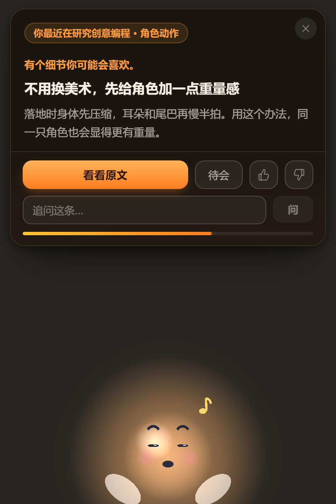
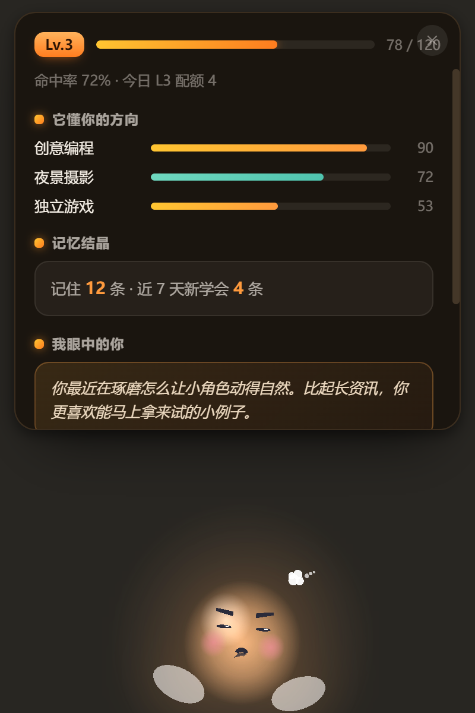
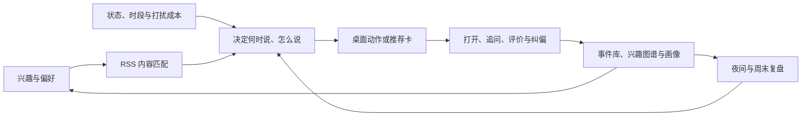

# Elf Buddy

**一只会记住你的兴趣、懂得什么时候找你说话的 Windows 桌面精灵。**

工作做完一段、刚好有空时，它可以带来一件和你有关的新鲜事。你可以问一句「这和我最近在做的东西有什么关系」，也可以告诉它「这个方向我以后不看了」。这些互动会影响下次说什么、什么时候说，以及该说多详细。

## 看一眼它如何陪你

<table>
  <tr>
    <td align="center"><br>带着理由推荐，也可以当场追问</td>
    <td align="center"><br>在成长面板查看精灵记住了什么</td>
  </tr>
</table>

截图来自公开版的实际 Electron 界面，内容和记忆记录使用演示数据。

## 场景与功能

| 你的场景 | 精灵能做什么 |
| --- | --- |
| 忙了一阵，想在间隙看看自己感兴趣的事 | 根据兴趣筛选订阅内容。结合空闲时长、前台应用类别、锁屏和安静时段，决定安静陪伴、做动作提示，还是讲一件事。 |
| 它推荐了一条资讯，你想知道凭什么推荐 | 卡片带推荐理由、摘要和原文入口。支持追问「这里最值得看什么」，对话会带上当前卡片的上下文。 |
| 兴趣变了，或者讨厌它老讲同一种内容 | 用赞踩、追问和打开原文表达喜好，也可以直接纠偏。精灵记录有来源的兴趣和事实，后续推荐会参考这些变化。 |
| 隔了一段时间，想知道自己最近都在关注什么 | 双击精灵可查看兴趣温度、记忆数量和偏好描述。精灵还可以生成晨报、日记或每周成长汇报。 |
| 想让它有自己的样子，或者腾不出手打字 | 可以命名、调整眼型和装饰、选图片皮肤，拖动或戳它会有动作。打开麦克风后，可以喊它的名字，用语音追问或设提醒。 |

## 为什么它会越用越懂你

### 会挑时机，也会保持安静

推荐分数同时看内容价值、用户状态、时段和打扰成本。会议、锁屏或安静时段等状态会限制主动提示。分数和配额决定是轻微发光、跳动吸引注意，还是展示完整气泡。低于阈值时精灵保持安静。 [时机引擎](elf-brain/app/timing/engine.py) · [用户状态](elf-brain/app/perception/state_machine.py)

### 记得你在意的事，也允许你改口

明确选择的主题、对话里抽取的事实和交互带来的偏好变化，保存在本地 SQLite 兴趣图谱和画像中。兴趣有温度，会随持续关注或冷却而变化。用户纠偏后，旧事实可以归档。成长面板把部分兴趣与记忆状态呈现出来。 [兴趣图谱](elf-brain/app/memory/interest_graph.py) · [事实抽取](elf-brain/app/memory/fact_extractor.py)

### 根据真实反馈复盘，再调整下次的策略

每次推荐都有自己的决策 ID。点击、停留、追问、赞踩和关闭等事件与决策一起记录，便于知道某一次开口的结果。后台复盘用这些样本校准评分和时机系数。启用模型时，周复盘还可以提炼选题经验，先在过去的反馈样本上回放检查，再将通过的经验用于以后的推荐。这里的成长落在本地记忆、推荐参数和表达策略上。 [反馈归因](elf-brain/app/speak/renderer.py) · [复盘与经验回放](elf-brain/app/review/pipeline.py)



## 在 Windows 上启动

使用 Windows 10/11、PowerShell、Python 3.12。推荐用 Node.js 22。缺少 Node.js 时脚本会尝试下载便携版，首次启动需要联网获取依赖与 PixiJS。

```powershell
git clone https://github.com/lanszdg/Elf-buddy.git
Set-Location Elf-buddy
.\start.ps1
```

首次启动时选名字、外观、兴趣和 RSS 来源。**点一下**可以互动，**双击**查看成长，**右键**打开设置。想测试本地提醒，可以在对话里输入「提醒我 20 分钟后休息」。

- **模型服务**。在设置里填写 OpenAI 兼容的 Base URL、API key 与模型名。开发时也可将 `elf-brain/.env.example` 复制到 `elf-brain/data/.env`，填写后重启后端。实际密钥放在本机。没有配置模型时，可体验桌宠、RSS 规则筛选和本地提醒。
- **语音与皮肤**。首次打开麦克风后，语音识别模型按需下载。已有图片也可以用作皮肤，如需本地自动抠图，在安装 npm 依赖后执行 `.\scripts\prepare-assets.ps1 -WithSkinCutout`。 [ISNet 模型和许可](https://huggingface.co/onnx-community/ISNet-ONNX)
- **便携版打包**。在仓库根目录执行 `.\scripts\build.ps1`，产物位于 `elf-shell/release-new/`。

## 公开文件结构

| 位置 | 它负责什么 |
| --- | --- |
| `elf-shell/electron/`、`elf-shell/src/` | Electron 桌宠窗口、Vue 交互、PixiJS 动画、桌面状态与语音采集 |
| `elf-brain/app/content/`、`perception/`、`timing/` | 候选内容、状态判断、开口评分 |
| `elf-brain/app/memory/`、`growth/`、`review/` | SQLite 事件和兴趣图谱、关系成长、反馈复盘 |
| `elf-brain/app/main.py` | FastAPI 路由、WebSocket 和后台调度 |
| `scripts/`、`start.ps1` | 首次依赖准备、开发启动与 Windows 打包 |
| `media/` | 为 README 单独截取的公开演示 |

桌宠壳与 Python 后端通过 `127.0.0.1:8787` 上的 HTTP 和 WebSocket 通信。麦克风音频用于本机唤醒和识别。配置外部模型或使用在线朗读时，相关文本会发给相应服务。本机数据库、实际配置、用户头像、日志与安装包都放在本地目录。
